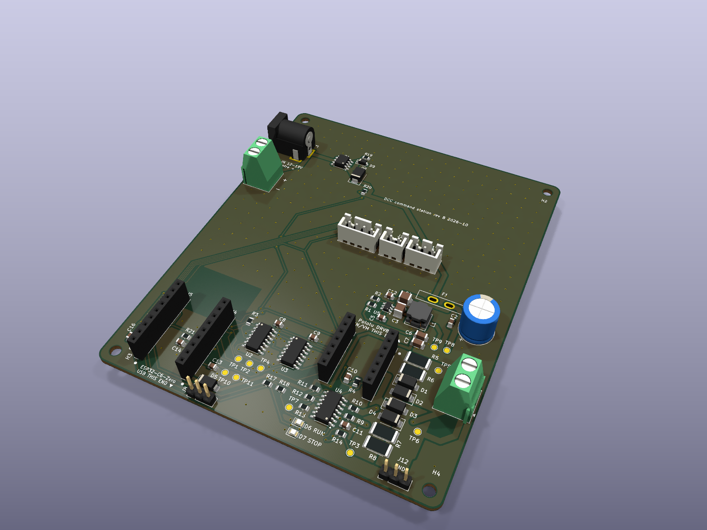

# DCC command-station board

The board of the DCC-esp32 command station: 100 x 120 mm, two layers, powered by an external 12–19 V adapter. A Waveshare ESP32-C6-Zero and a Pololu DRV8874 carrier plug into its sockets.

## Status

Rev B is the current design. It was built by JLCPCB and works on a 15 V bench supply on J9: power, ESP32, display, LEDs, Wi-Fi, DCC to the track and RailCom reads, and it starts with the display unplugged. Not tried yet: a reversed supply, the buttons, a 19 V supply and a short on the track.

Rev A (PR #41, commit ceebd3d) was built by JLCPCB and works on a 15 V bench supply: power, ESP32, display, LEDs, buttons, Wi-Fi, DCC to the track and RailCom reads. It carried a 230 V mains module on the board. Do not connect a rev A board to the mains: power it with 15 V on the module's output pins, as it was tested.

What rev B changes:

- no mains on the board; power comes from a certified adapter through a barrel jack;
- reverse-polarity protection and a transient suppressor on the input;
- the input voltage is divided down to GPIO0, for a firmware check of the supply (not written yet);
- a screw terminal for a bench supply;
- three panel connectors instead of one, each cable with its own ground;
- pull-up resistors on the display bus, so the bus is defined with the display unplugged.

The CPL already carries the rotation corrections for JLCPCB's footprints; one exported again from KiCad would not.

## Power

Use a regulated adapter of 12 to 19 V, at least 2.5 A, with a 5.5 x 2.5 mm plug, centre positive, double insulated (Class II, the square-in-a-square symbol). Choose the voltage by scale: the track gets the adapter voltage minus about 1 V under load (bridge, clamp diodes, fuse), so 12 V for N and 15 V for H0.

A 5.5 x 2.1 mm plug goes into the 2.5 mm jack but makes poor contact; use the right plug.

Never use a 24 V adapter, even though it has the same plug. Nothing on the board is damaged by it, but the decoders would get 23 V, and the firmware does not check the input voltage yet.

For bench work, a bench supply can be connected to the screw terminal J9 ("+" and "−" on the silkscreen) instead of the adapter. Never use both at once: a bench supply set above the adapter would push current into it.

USB and the adapter can be connected at the same time.

## Parts bought separately

- Waveshare ESP32-C6-Zero on J4 and J5, USB-C toward the bottom edge.
- Pololu DRV8874 carrier #4035 on J6 and J7, VM and VIN at the top.
- SSD1306 I2C display at 3.3 V.
- Two normally-open push buttons, resume and stop.
- Three JST XH cables for the lid, pin 1 at the square pad:
  - J3, DISPLAY, 4 ways: 1 ground, 2 3.3 V, 3 display data, 4 display clock. Keep the cable under 20 cm.
  - J10, RESUME, 2 ways: 1 ground, 2 button.
  - J11, STOP, 3 ways: 1 ground, 2 button, 3 not connected. The third way keeps the stop cable out of RESUME; label both ends of the resume cable, since a 2-way housing can still be pushed into STOP.
- The adapter described under "Power", and a box.

J12, on the bottom edge right of the sense resistors, is three ground pins for an oscilloscope probe's ground clip.

`fab/dcc-station.step` is the 3D model of the assembled board, for designing a box. The barrel jack J1 sits on the left edge, where the box needs a round opening for the plug; C1 is 16 mm tall.

## Editing

Open `dcc-station.kicad_pro` in KiCad 10. The symbol of Q1 (AO4407A) is in `symbols/dcc.kicad_sym`, the footprints of F1 and of the barrel jack J1 (pads from the XKB drawing) in `footprints/dcc.pretty`.

## Licence

CERN Open Hardware Licence v2, strongly reciprocal ([`LICENSE`](LICENSE)).
