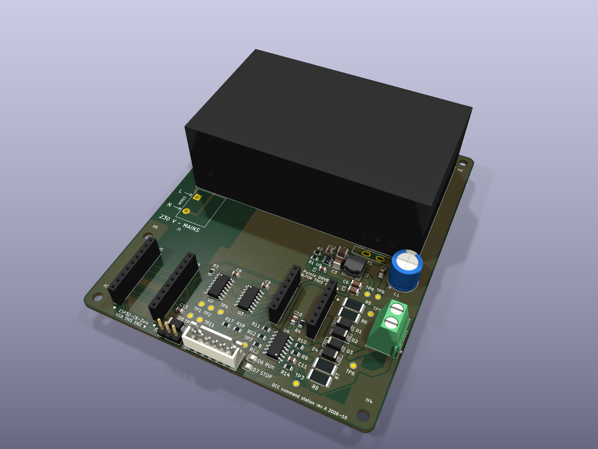

# DCC command-station board

The board of the DCC-esp32 command station: 100 x 120 mm, two layers, powered from 230 V through an on-board Mean Well IRM-45-15. A Waveshare ESP32-C6-Zero and a Pololu DRV8874 carrier plug into its sockets.

## Status

Rev A was built by JLCPCB from the files in [`fab/`](fab/) and works on a 15 V bench supply: power, ESP32, display, LEDs, buttons, Wi-Fi, DCC to the track and RailCom reads.

- Known defect: the display bus (GPIO19, GPIO20) has no pull-up resistors on the board. Without the display on J3 the firmware restarts in a loop, so keep it connected.

The CPL already carries the rotation corrections for JLCPCB's footprints; one exported again from KiCad would not.

## Parts bought separately

- Waveshare ESP32-C6-Zero on J4 and J5, USB-C toward the bottom edge.
- Pololu DRV8874 carrier #4035 on J6 and J7, VM and VIN at the top.
- SSD1306 I2C display at 3.3 V.
- Two normally-open push buttons, resume and stop.
- 6-way JST XH cable for J3: 1 ground, 2 3.3 V, 3 display data, 4 display clock, 5 resume button, 6 stop button. Buttons go between their pin and ground.
- For 230 V: an IEC C14 inlet with a T1AH fuse, and a box.

`fab/dcc-station.step` is the 3D model of the assembled board, for designing a box.

## Safety

The board carries 230 V. Only distance and the box protect the mains corner (J1 and the module's input). The box must keep at least 6.4 mm of air between any 230 V part and anything a person can touch, have a screwed cover over the mains corner, be printed in UL94 V-0 filament, and use a nylon screw in hole H1. Wire the inlet with the fused live to J1 pin 1 (L), neutral to pin 2 (N), earth tab capped. This design is not certified.

Never plug USB in with the mains on.

## Editing

Open `dcc-station.kicad_pro` in KiCad 10. The footprints of F1 and J1 are in `footprints/dcc.pretty`; `dcc-station.kicad_dru` holds the extra rules for the 230 V area.

## Licence

CERN Open Hardware Licence v2, strongly reciprocal ([`LICENSE`](LICENSE)).
